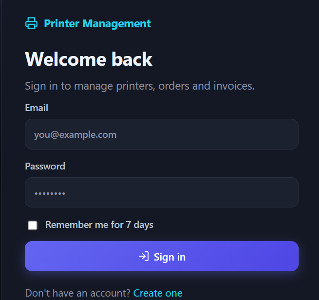
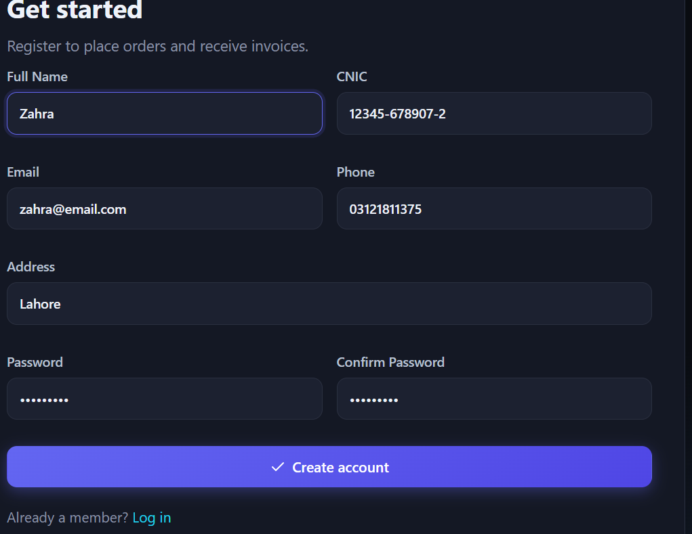
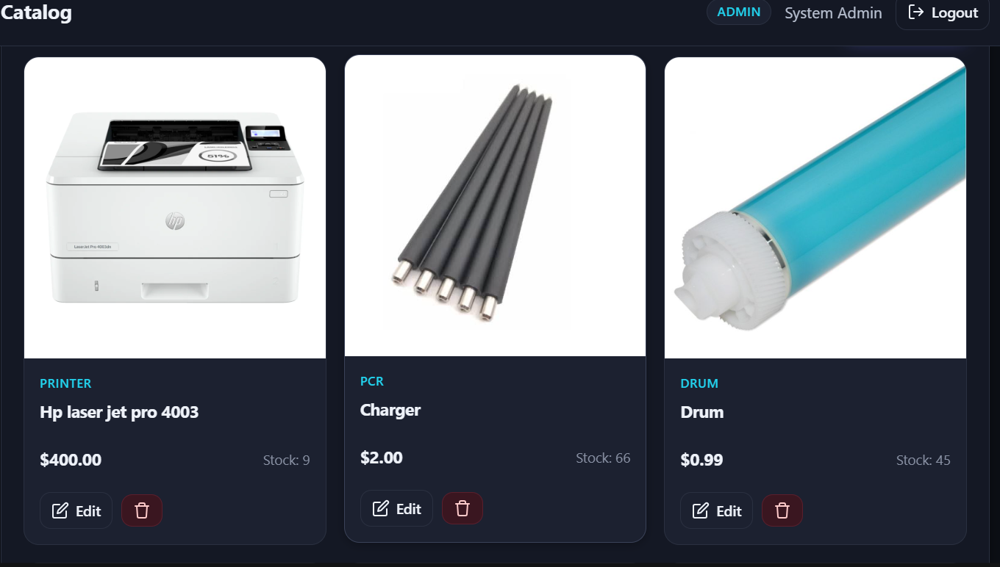
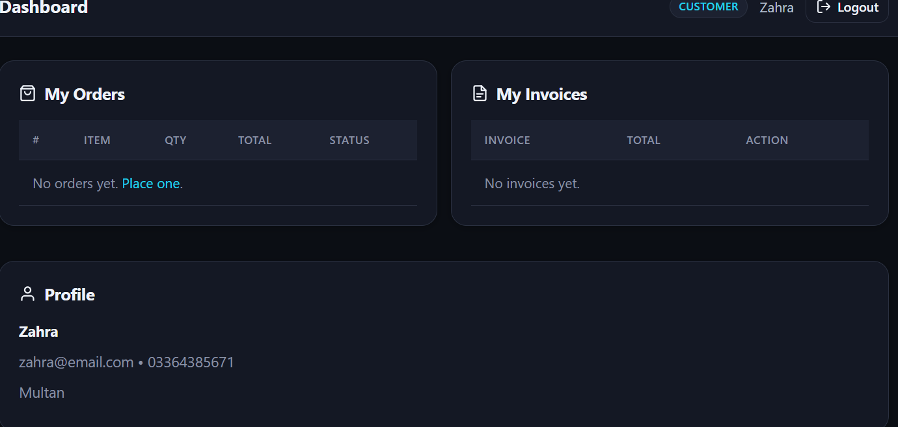
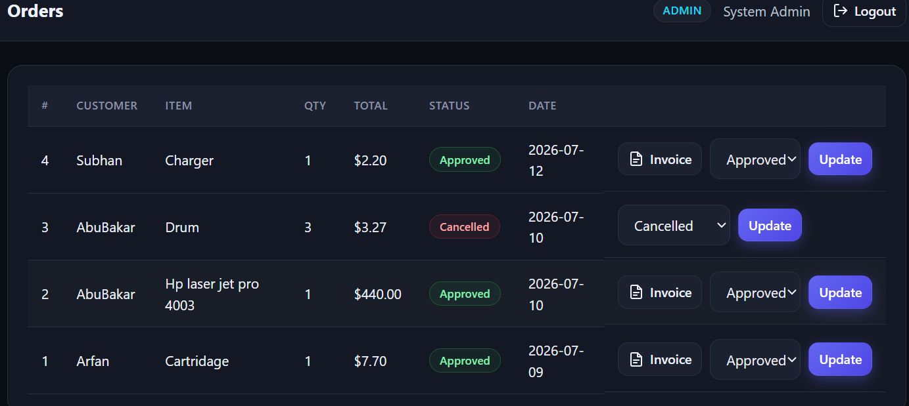
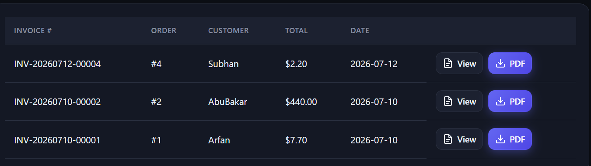

# Printer Management System

A professional full-stack **FastAPI + Jinja2 + SQLite** application to manage
printers (and related consumables), customers, orders, invoices and business
reports. Ships with a modern dark UI, complete icon set, JWT authentication,
phone OTP simulation and PDF/CSV exports.

---

## Features

- **Authentication** — JWT (HTTP-only cookie), signup with strong-password rules, remember-me.
- **Phone OTP** — simulated 6-digit code, 2-minute expiry, resend, max 3 attempts.
- **Roles** — `admin` (auto-seeded) and `customer`.
- **Catalog** — Printers, Cartridges, PCRs, Charger Rollers, Drums, Blades. Search, filter, image upload.
- **Orders** — Place, approve/cancel/complete, auto stock adjustment.
- **Invoices** — Auto-generated on approval, GST 10 %, view / print / download PDF.
- **Reports** — Revenue, GST, orders, customers, inventory. CSV & PDF export.
- **Modern UI** — Inter font, Lucide-style SVG icon system, responsive dark theme, toasts, modals.

---

## Admin Login (auto-seeded)

| Field    | Value                 |
|----------|-----------------------|
| Email    | `admin@printer.com`   |
| Password | `Admin@123`           |

---

## Run locally (VS Code)

### 1. Prerequisites

- Python **3.10+** (3.11 or 3.12 recommended)
- pip

### 2. Setup

**Windows (PowerShell / CMD)**

```bat
python -m venv venv
venv\Scripts\activate
pip install -r requirements.txt
python run.py
```

**macOS / Linux**

```bash
python3 -m venv venv
source venv/bin/activate
pip install -r requirements.txt
python run.py
```

The server starts at **http://127.0.0.1:8000**.
`printer_management.db` is created on first launch and sample printers are seeded.

### 3. Open in VS Code

```bash
code .
```

Recommended extensions: **Python**, **Pylance**, **Jinja**.

---

## OTP demo

The OTP is generated server-side and — for demo purposes — shown in the
toast message on the verify page and printed to the server console
(`[OTP] <phone> -> <code>`). Swap `app/services/otp_service.py` with your
SMS provider (Twilio, MessageBird, etc.) to go live.

---

## Project layout

```
printer_management_system/
│
├── app/
│   ├── main.py
│   ├── config.py
│   ├── database.py
│   ├── dependencies.py
│   │
│   ├── models/
│   │   ├── user.py
│   │   ├── customer.py
│   │   ├── printer.py
│   │   ├── order.py
│   │   └── invoice.py
│   │
│   ├── schemas/
│   ├── services/
│   ├── routes/
│   └── utils/
│
├── templates/
│
├── static/
│   ├── css/
│   │   └── style.css
│   ├── js/
│   │   └── app.js
│   └── images/
│       └── pms-logo.svg
│
├── screenshots/              ⭐ NEW FOLDER
│   ├── login.png
│   ├── signup.png
│   ├── dashboard.png
│   ├── printers.png
│   ├── customers.png
│   ├── orders.png
│   └── invoices.png
│
├── tests/
├── requirements.txt
├── run.py
├── .env
└── README.md
```

---

## Environment variables (`.env`)

| Key                             | Default                              |
|---------------------------------|--------------------------------------|
| `SECRET_KEY`                    | dev key — **rotate in production**   |
| `DATABASE_URL`                  | `sqlite:///./printer_management.db`  |
| `ACCESS_TOKEN_EXPIRE_MINUTES`   | `60`                                 |
| `GST_RATE`                      | `0.10`                               |

---

## Tests

```bash
pip install pytest httpx
pytest -q
```

---

## License

MIT — free to use, modify and distribute.
---

## 📸 Project Screenshots

### Login Page


### Signup Page


### Admin Dashboard


### Printer Management


# Customer Management


### Order Management


### Invoice Management


---


## 7. Invoice Management

